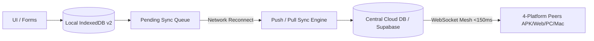

# সমিতি ৩৬০ (Somiti 360) — v2.0.0 (Build 20)
**অফলাইন-ফার্স্ট হাইব্রিড সুপার অ্যাপ | ডিজিটাল সমিতি, সমবায় সংস্থা, সঞ্চয় ও ক্ষুদ্রঋণ ব্যবস্থাপনা প্ল্যাটফর্ম**


সমিতি ৩৬০ একটি বাণিজ্যিক মানের, ১০০% জিরো-ডেমো ডিজিটাল সমবায় প্ল্যাটফর্ম। এটি সম্পূর্ণ **Offline-First Hybrid Architecture**-এ তৈরি, যার ফলে ইন্টারনেট সংযোগ ধীরগতির, অস্থিতিশীল বা সম্পূর্ণ বিচ্ছিন্ন থাকলেও মেম্বার ভর্তি, জমা কালেকশন, খরচ এন্ট্রি, ক্যাশ খতিয়ান ও ড্যাশবোর্ড নিরাপদে পরিচালনা করা যায়। ইন্টারনেট ফিরে এলে ডুপ্লিকেট-রোধী আইডিম্পোটেন্সি কি (RFC4122 v4) এবং ইনক্রিমেন্টাল কার্সর সিঙ্ক ইঞ্জিনের মাধ্যমে ক্লাউড ডাটাবেজের সাথে ডেটা সিঙ্ক হয়।

---

## 🌐 লাইভ ও ডাউনলোড লিংকসমূহ (Multi-Platform Parity)

| প্ল্যাটফর্ম | লিংক / ডাউনলোড | বিবরণ |
|---|---|---|
| 📱 **Android Mobile APK** | [Somiti-360-v2.0.0-build20-android.apk](https://github.com/sajjadhossan/somiti-360/releases/latest) | স্মার্টফোনে সরাসরি ডাউনলোড ও ইন্সটল |
| 💻 **Windows Desktop Setup** | [Somiti-360-Setup.exe](https://github.com/sajjadhossan/somiti-360/releases/latest) | উইন্ডোজ পিসি ইন্সটলার |
| ⚡ **Windows Portable** | [Somiti-360-PC.exe](https://github.com/sajjadhossan/somiti-360/releases/latest) | ইনস্টল ছাড়া পোর্টেবল সংস্করণ |
| 🍏 **MacBook Apple Silicon** | [Somiti-360-Mac-AppleSilicon.dmg](https://github.com/sajjadhossan/somiti-360/releases/latest) | M1/M2/M3/M4 অ্যাপল সিলিকন |
| 🍏 **MacBook Intel** | [Somiti-360-Mac-Intel.dmg](https://github.com/sajjadhossan/somiti-360/releases/latest) | ইন্টেল প্রসেসর ম্যাকবুক |
| 🌐 **Vercel Web PWA** | [https://somiti-360.vercel.app](https://somiti-360.vercel.app) | প্রোগ্রেসিভ ওয়েব অ্যাপ (অফলাইন শেল ক্যাশড) |

---

## 🚀 নতুন অফলাইন-ফার্স্ট সুপার অ্যাপ আর্কিটেকচার (v2.0.0)



### ১. লোকাল ডাটাবেজ (IndexedDB v2 Stores)
লোকাল ব্রাউজার ও এপিকে ওয়েবভিউতে ৫MB লোকালস্টোরেজ সীমাবদ্ধতা দূর করে ১২টি নন-ব্লকিং অবজেক্ট স্টোরে ডেটা ক্যাশ করা হয়:
- `cached_members`: সদস্য প্রোফাইল ও মাসিক কিস্তি তথ্য
- `cached_deposits`: জমার খতিয়ান ও ব্যাংক রসিদ
- `cached_receipts`: রসিদ ও ভেরিফিকেশন কোড
- `cached_expenses`: ব্যয় ও ভাউচার
- `cached_documents`: রেজোলিউশন ও অফিসিয়াল নোটিশ
- `cached_reports`: অডিট রিপোর্ট ক্যাশ
- `cached_dashboard_summary`: তাৎক্ষণিক ড্যাশবোর্ড ওভারভিউ
- `pending_sync_queue`: আইডিম্পোটেন্সি কি সহ অফলাইন মিউটেশন কিউ
- `sync_conflicts`: আর্থিক তথ্যের বিরোধ ট্র্যাকিং
- `sync_logs`: ক্লায়েন্ট সিঙ্ক অডিট জার্নাল
- `offline_files`: অফলাইনে সংরক্ষিত ব্যাংক স্লিপ ও রশিদের ছবি
- `app_metadata`: কার্সর টাইমস্ট্যাম্প ও সিস্টেম মেটাডাটা

### ২. নিরাপদ কনফ্লিক্ট রেজোলিউশন (Zero Silent Overwrites)
- **আর্থিক তথ্য (জমার পরিমাণ, ব্যাংক রসিদ নম্বর, স্ট্যাটাস):** কখনো স্বয়ংক্রিয়ভাবে ওভাররাইট হয় না। সার্ভার-অথরিটেটিভ ভ্যালিডেশন ব্যর্থ হলে কনফ্লিক্ট রেকর্ড তৈরি হয় এবং অ্যাডমিনের জন্য ডেটা তুলনা ও ম্যানুয়াল নিষ্পত্তির ডায়ালগ ওপেন হয়।
- **অ-আর্থিক তথ্য (ঠিকানা, মন্তব্য, ছবি):** সার্ভার টাইমস্ট্যাম্প ভিত্তিক নির্ভরযোগ্য Last-Write-Wins (LWW)।

### ৩. ব্যাকএন্ড সিঙ্ক এপিআই এন্ডপয়েন্টসমূহ
- `POST /api/sync/push` — অফলাইন পরিবর্তনসমূহ আপলোড ও আইডিম্পোটেন্সি সুরক্ষা
- `GET /api/sync/pull` — কার্সর ভিত্তিক ইনক্রিমেন্টাল ডেল্টা ডাউনলোড
- `GET /api/sync/status` — ডিভাইস কার্সর ও ডাটাবেজ কানেক্টিভিটি স্থিতি
- `POST /api/sync/conflicts/resolve` — বিরোধ নিষ্পত্তি এপিআই
- `POST /api/sync/items/retry` — ব্যর্থ সিঙ্ক আইটেম রিট্রাই
- `POST /api/sync/bulk` — বাল্ক অফলাইন ট্রানজ্যাকশন সিঙ্ক
- `GET /api/health` — সিস্টেম আপটাইম ও ডাটাবেজ লেটেন্সি
- `GET /api/app/version` — ভার্সন ২.০.০ ও ফোর্স-আপডেট চেক

---

## 🛠️ ডেভেলপার কমান্ডসমূহ ও টেস্ট স্যুট

```bash
# ডিপেন্ডেন্সি ইনস্টল
npm install

# অফলাইন সিঙ্ক ও সিস্টেম ভেরিফিকেশন টেস্ট (২৩টি টেস্ট)
npm test

# লোকাল ডেভেলপমেন্ট সার্ভার
npm run dev

# প্রোডাকশন ওয়েব বান্ডেল বিল্ড
npm run build

# উইন্ডোজ ডেস্কটপ অ্যাপ বিল্ড
npm run electron:build

# ম্যাকবুক অ্যাপ বিল্ড (Intel ও Apple Silicon)
npm run electron:build:mac
```

---

## 🔒 নিরাপত্তা ও পারফরম্যান্স স্ট্যান্ডার্ড
1. **টোকেন ও গোপনীয়তা:** কোনো পাসওয়ার্ড, গোপন এপিআই কি বা টোকেন লোকাল স্টোরেজে সংরক্ষণ করা হয় না।
2. **ক্যাশ সুরক্ষা:** সংবেদনশীল আর্থিক এপিআই কোনো উন্মুক্ত শেয়ার্ড HTTP ক্যাশে রাখা হয় না; এগুলো কেবল এনক্রিপ্টেড লোকাল IndexedDB-তে ক্যাশ হয়।
3. **মাল্টি-টেন্যান্ট আইসোলেশন:** প্রতিটি ডেটায় `tenant_id` কঠোরভাবে নিয়ন্ত্রিত।
4. **কোড-স্প্লিটিং:** ভারী মডিউলগুলো (ডকুমেন্ট ভেরিফিকেশন পোর্টাল, কনফ্লিক্ট রেজোলিউশন) ডায়নামিক `React.lazy()` ও `Suspense`-এর মাধ্যমে স্প্লিট করা, যা প্রাথমিক লোড অত্যন্ত দ্রুত রাখে।
